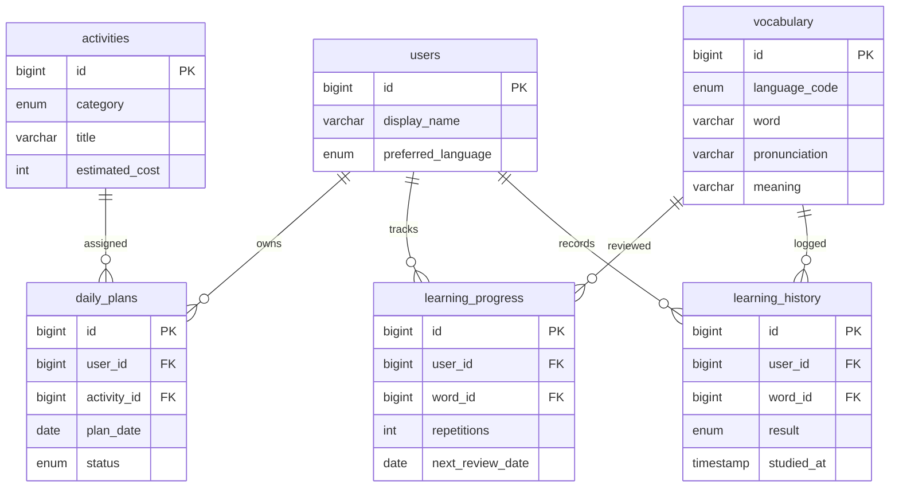

# ERD 및 테이블 정의

- PK: 각 테이블 id.
- FK: daily_plans.user_id→users.id, activity_id→activities.id; learning_progress/learning_history의 user_id→users.id, word_id→vocabulary.id.
- UNIQUE: (user_id, plan_date), (language_code, word), (user_id, word_id), activities.title.
- INDEX: learning_progress(user_id, next_review_date).
- 삭제 정책: 사용자 삭제 시 일정·학습 기록 CASCADE; 단어 삭제 시 학습기록 CASCADE; 활동은 일정이 연결되면 삭제 제한.
- 상세 실행 SQL: `sql/schema.sql`.
