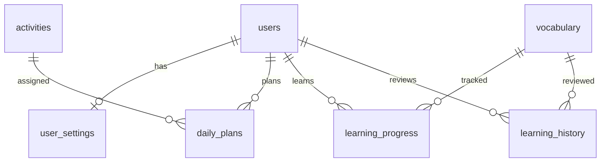

# V1.2 생활 유형·요일별 일정 설계

## 요구사항
- 생활 유형: 직장인 / 자유시간형(구직·은퇴·휴직 등). 누구나 선택 가능.
- 일정 방식: 매일(평일+주말) / 주말만(토·일).
- 직장인 평일: 40분 이하 활동 우선, 주말: 60분 이상 활동 우선.
- 자유시간형 평일: 건강·배움·여행·취미, 주말: 관계·여행·취미 우선.
- 매일 모드에서 평일·주말은 서로 다른 규칙으로 자동 생성.
- 주말 모드는 토요일과 일요일에만 일정 생성.
- 외국어 학습은 일정 모드와 관계없이 매일 이용 가능하며 5개 언어 지원.
- 기본 생성은 기존 일정 보존. 재생성 선택 시 미완료 일정만 변경하고 완료 일정은 보호.

## 분석표
| 화면/기능 | 입력 | 처리 | 저장/출력 |
|---|---|---|---|
| 생활 방식 설정 | 직장인/자유시간형, 매일/주말 | 값 검증 | user_settings |
| 월간 계획 생성 | 월, 재생성 여부 | 요일 및 유형별 활동 선택 | daily_plans |
| 활동 완료 | 일정 ID, 상태 | 완료 시각 기록 | daily_plans |
| 외국어 학습 | 언어, 복습 결과 | 간격 복습 | learning_progress/history |

## ERD

user_settings: user_id PK/FK, employment_type ENUM(worker,free), schedule_mode ENUM(daily,weekends), updated_at.

## 5줄 요약
1. 스마트폰에서 직장인과 자유시간형 생활 패턴을 선택한다.
2. 매일 또는 주말만 월간 일정을 생성한다.
3. 직장인은 평일 짧게, 주말 길게 활동하도록 추천한다.
4. 외국어 5개 언어의 발음·단어·복습은 매일 이용할 수 있다.
5. MySQL이 개인 설정·일정·완료 기록·학습 이력을 보관한다.
